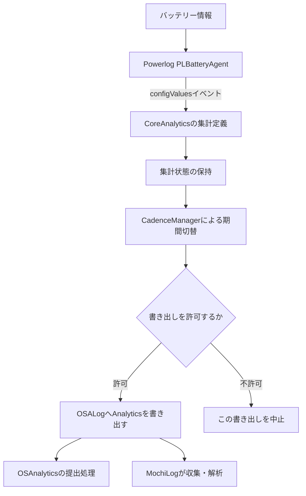

# Analytics生成処理と27.2の識別子取得の調査

調査日: 2026-11-19。対象ソース: MochiLog `73b2f7c` を基準とする main。
これは開発者向けの静的解析・再現試験の記録であり、Appleが公開した仕様書ではない。
顧客のAnalyticsファイル本体は未入手。顧客端末の原因を確定した記録ではない。

## 結論

- 27.0.1と27.2のIPSWにあるバッテリー集計の3定義は構造的に一致した。
  容量・サイクル数のキーが27.2で一律に削除・改名された証拠は得られていない。
- 通常のAnalytics書き出しには、解析共有の有効状態を確認して書き出しを中止する分岐がある。
  バッテリーのイベント生成、集計、ファイルへの書き出し、アップロードは別工程。
- OS更新、端末再起動、デーモン再起動、集計期間の再開・期限超過を区別している。
  部分データのフラグ、状態DBの再作成、書き出し失敗処理も存在する。
  ただし「アップデートしたら必ずログが欠ける」という因果までは確認していない。
- 保存済み90件は全件パーサーを通過し、最短は115行・77,901 bytesだった。
  正常なバッテリーログも短くなり得る。行数だけでは良否を判定できない。
- Mac/Windowsには100改行未満を除外する条件がある。
  合成した完全なバッテリー入力でも、この条件によりPC側だけが除外することをMacで再現した。
  顧客のファイルがこの条件に該当するかは不明。この調査では製品側の条件を変更していない。
- 27.2シミュレーターで `sysctlbyname("hw.machine")` の失敗は再現しなかった。
  ただしシミュレーターの返値は `arm64` であり、実機の `iPhone18,4` 等を証明する試験ではない。

## 資料と手法

Apple CDNから次のIPSWをダウンロードし、BuildManifestの製品・OS・ビルドを確認した。
復元・フラッシュは実施していない。展開イメージを読み取り専用でマウントし、設定、実行ファイル、
dyldキャッシュ内の対象フレームワークを静的解析した。

| 製品 | OS | Build | bytes | SHA-256 |
| --- | --- | --- | ---: | --- |
| iPhone14,4 | 27.0.1 | 24A446 | 11,170,312,335 | `cac2ee4248bf36e8a14afc39ac6594f2950e4e578b85901c7a97bd4eaad21052` |
| iPhone14,4 | 27.2 | 24B119 | 11,440,884,372 | `41271ff8826f041a041c71a0cb7a265980a883deecc6cc8b3ad2caa4e84951c7` |

一次資料:

- [Apple 27.0.1 IPSW](https://updates.cdn-apple.com/2026FallFCS/0748752a-4554-47fe-b07e-36b5702830b8/iPhone14,4_27.0.1_24A446_Restore.ipsw)
- [Apple 27.2 IPSW](https://updates.cdn-apple.com/2026FallFCS/21a77e9c-f77a-4350-a47e-d5083375d0b2/iPhone14,4_27.2_24B119_Restore.ipsw)
- [解析ツール ipsw](https://github.com/blacktop/ipsw): 3.1.749、commit `a7dfadbcaca8375b424c12a68dae40767e5e07c1`。
  macOS arm64配布tarballのSHA-256は `59267f18a579caf435f764b6fa64652602f21aa07c8cb7c894fc334ad09ecae4`。

対象は特定の製品・ビルド。全モデルの27.2、配信後の動的設定、顧客実機の状態を代表するものではない。
Appleバイナリ、IPSW、顧客情報、生ログはGitへ追加しない。

## 生成パイプライン



これは解析した経路を要約した図で、OS内部全体の完全な仕様ではない。
「Appleへの送信待ち」と「ファイル自体がまだ作られていない」は区別する。

### バッテリーイベントと集計

27.2のPowerlogLiteOperatorsに
`-[PLBatteryAgent logBatteryConfigToCA:forBatteryPack:]` がある。
`0x29fcbb13c–0x29fcbb148` でイベント名
`com.apple.power.battery.configValues` と `_AnalyticsSendEventLazy` の呼び出しを確認。
`logEventNoneBatteryConfigWithRawData:` には各バッテリーキーの取り出しと例外処理がある。
入力取得・イベント通知に成功しても、最終ファイルに必要値が必ず揃うとは限らない。
なおイベント名の `configValues` は、ユーザーの共有設定そのものを意味しない。

CoreAnalytics.framework/Supportの `defaultConfig.json` はNDJSON形式。
27.2は15,923 JSONオブジェクトで、単一JSONとして読むと誤る。
比較したバッテリー定義は次のとおり。

| Transform | measures | 入力 | outputsのsink | enableIf |
| --- | ---: | --- | --- | --- |
| BatteryConfigValueHistogram_Corrected | 73 | configValues_DO_NOT_USE | Never | なし |
| BatteryConfigValueHistogram_WithAllSafetyKeys_V2 | 106 | configValues | Daily | 端末ごとの安定乱数bucketが10未満 |
| BatteryConfigValueHistogramFinal_V2 | 87 | configValues | Never | なし |

3定義の全オブジェクトを比較して一致した。必須3値はどれも `int`、集計関数は `last`:

| 出力キー | 入力フィールド |
| --- | --- |
| last_value_CycleCount | CycleCount |
| last_value_NominalChargeCapacity | NominalChargeCapacity |
| last_value_AppleRawMaxCapacity | AppleRawMaxCapacity |

SafetyKeysの抽出条件を「通常のバッテリー記録が10%の人にしか生成されない」と解釈してはいけない。
通常のFinal_V2にはそのenableIfがない。また `Never` を「ファイルに絶対出ない」と解釈してはいけない。
実ログのDailyレポートにFinal_V2が含まれており、書き出し側には永続化済み集計状態を列挙する経路
（analyticsd `0x1000d12e8` 付近）もある。sinkの完全な意味は未確定。
`last` の集計値を1秒ごとの生データとして扱うこともできない。

通常設定全体のSHA-256はOS間で異なる:

- 27.0.1: `3a348a1d42c093d06dcf7094e0118beed317ab2c54c484c726e3b6419e991d51`
- 27.2: `eeca92aaa238653cdd88253931cf27ddcd76c6197a9d2f0f907359a99a695394`

一致は「バッテリー3定義」についての結果であり、OS全設定の一致ではない。

### 共有設定と別種の短いレポート

analyticsd `0x1000d25b4–0x1000d2680` 付近の通常iPhone経路は
`OSASystemConfiguration.sharedInstance.optInApple` を確認し、falseなら書き出し不可を返す。
`skipLogWriting` による別の停止条件もある。
Sinkの `0x1000cf684` の判定がfalseの場合は、`0x1000cf708` の書き出し中止経路へ進む。

OSAnalyticsの `optInApple`（`0x1b1dc7adc`）はDRE用の分岐を持ち、通常側では
ManagedConfigurationの `MCFeatureDiagnosticsSubmissionAllowed` を読み、
`boolValForMCSetting:`（`0x1b1dca850`）で有効状態を判定する。
後者にはManagedConfigurationが使えない場合のMobileGestaltフォールバックもある。
これは単なるネットワーク接続可否の判定ではない。
ただし、非公開APIを製品へ組み込んだり、App Storeアプリから同じ設定を確実に取得できるとする根拠にはならない。

`defaultOptOutConfig.json` は2オブジェクト、configTypeはOptOut。
唯一のCensus集計はWeeklyで、バッテリー定義はない。
従って「Analyticsという名前のファイルなら必ず容量情報がある」は成立しない。
ただし顧客の短いファイルがこのCensusだったとは確認していない。

analyticsdにはCDNから設定を取得・保存・有効化する処理もある。
従って、IPSW同梱設定がその時点の実機で有効な設定と完全に同じとは限らない。

### OS更新、再起動、期間切替、失敗

| 確認箇所（27.2 analyticsd） | 確認内容 | 言える範囲 |
| --- | --- | --- |
| `0x1000325f4` 付近 | 以前と現在のOSビルドを比較し、更新状態を区別 | 更新を通常再開と別扱いしている |
| `0x10003268c` / `0x1000326c0` 付近 | AFTER RESTART / AFTER REBOOT | デーモン再始動と端末再起動を区別する経路がある |
| `0x100032460` / `0x100032480` 付近 | PAST DUE / RESUME | 集計期間の期限超過と同期間の再開を区別 |
| `0x100098714` 付近 | OS UPDATE時のstartup rollover分岐 | 更新時の期間切替経路が存在する |
| `0x10003355c` | partial dataフラグを1に設定、その後状態保存 | 不完全な集計期間を表現できる |
| `0x1000992c4` 付近 | clean install以外の状態wipeでpartialを付ける処理とDB再作成 | 状態のリセットによる部分集計が想定されている |
| `0x100062548` / `0x1000635f0` 付近 | rolloverContainsPartialDataメタデータ | 期間切替の部分データ情報を扱っている |
| `0x1000cfe04` 付近 | 書き込んだメッセージ数を記録 | ログ長は一定の固定行数ではない |

OS更新の分岐があることだけで、全ての更新がpartialフラグを立てる、バッテリー行を消す、共有設定をオフにする、
とは断定しない。値がない原因には、イベント入力不足、設定選択、集計状態、期間切替、ファイル生成失敗が考えられるが、
顧客端末でどの経路が実行されたかは未確認。

osanalyticshelperのLaunchDaemonには、ネットワークと安価な回線を要求する提出タスク（3600秒周期）などがある。
これは提出処理のスケジュールであり、Analytics生成が1時間ごとという証拠ではない。
同様に設定取得のdaily timerをレポート生成タイマーと混同しない。
OSAnalyticsのbug_type 211設定はwatchSync=true、datavault=true。
このフラグだけでWatchの遅延原因やロック中の読み取り失敗原因まで確定はできない。

## 保存済みログ90件の検証

所有するPCの保管済みファイルをSHA-256で重複除外した。
既に収集・採用されたファイルの集合であり、OSが生成した全ファイルの無作為標本ではない。
生成されない割合、不正ファイルの頻度、100行未満の実在頻度は推定できない。

| 項目 | 結果 |
| --- | --- |
| OSヘッダー | iPhone OS 27.0.1: 60件、Watch OS 27.2: 24件、Watch OS 27.2 beta: 6件 |
| 期間 | 全90件がDaily、bug_type 211 |
| 行数 | 115〜21,421行 |
| 最短ファイル | 77,901 bytes、115行、40イベント種別、完全なバッテリー行1件 |
| パーサー実行 | 90件全て成功、必須3値を取得（容量検証は無効、DB保存・UI処理は対象外） |
| ヘッダー時刻の時 | 09時86件、00・11・13・15時が各1件 |

多くが日本時間09時だったが、固定時刻でしか存在しないという判定はできない。
ファイル時刻は今回ヘッダーを調べたもので、実際の生成完了や端末間の到着時刻と同一とは限らない。
行数には多数の無関係なイベントが含まれるため、長さをバッテリー測定回数と解釈しない。
この集合にはiPhone OS 27.2の生ログがなく、その互換性を実ログで保証する結果ではない。

## MochiLog側で再現した挙動

### モデル識別と欠測は別

製品の `DeviceLibrary.localModelIdentifier()` と同じsysctl実装を最小プローブへコピーし、
27.0 / 27.2のシミュレーターで実行した。仮想機種名は別途環境変数から取得した比較値。

| ランタイム | 仮想機種 | hw.machine / uname | sysctl結果 |
| --- | --- | --- | --- |
| 27.0 (24A434) | iPhone17 | arm64 | サイズ取得・値取得とも0、errno 0 |
| 27.2 (24B114) | iPhone17 | arm64 | 同上 |
| 27.2 (24B114) | iPhone13 mini | arm64 | 同上 |

27.2のプローブを画面に表示し、Device Hubのアクセシビリティ情報でも結果を確認した。
製品アプリ全体や実機での機種ID取得を検証した結果ではない。

`LogParser` はバッテリー必須値を確認した後に `deviceModelCode` を代入する。
従って必須値なしの失敗結果にはモデルが入らず、処理結果UIで「デバイス不明」になり得る。
この表示は `hw.machine` の失敗を示す診断ではない。

今回、既存パーサー試験に次の合成ケースを追加し成功を確認した:

- 機種フィールドあり／なしの完全な2行NDJSON、LF／CRLF。cycleCount=0も有効。
- 容量がnull、文字列、0の場合はinvalid format。
- 機種フィールドがあってもバッテリー行がない場合はno measurements。
- 既存試験の、完全なWatch行の後に欠測したshutdown行があるケースも成功。

これは未知のOSログ形式を新たに観測したという意味ではない。
行をまたいで整形したJSON、途中で切れたJSONなど、任意のJSON文書に対応するパーサーではない点は残る。

### PCの長さフィルター

Macの `Collector.batteryLogKind` 本体をそのまま抜き出したSwiftプローブを実行した。
合成ファイルは有効なOSヘッダーと必須3キー・正常値を持ち、末尾改行を付けた。

| 改行数 | モバイル側の必須値 | Macの分類 |
| ---: | --- | --- |
| 2 | 揃う | 除外 |
| 99 | 揃う | 除外 |
| 100 | 揃う | host |
| 115 | 揃う | host |

WindowsのCollectorにも同じ100改行条件があることをソースで確認した。
Windowsでこのプローブを実行した結果ではない。
実機由来の100行未満の正当なファイルは今回未確認。
今後見直す際は、PCにバッテリーパーサーを持たせず、セッション・別種レポート・欠測の除外と
有効な短いレポートの受け入れを両立し、Mac/Windowsの両方へ適用する。

## 再検証

バッテリー定義の比較は、各IPSWから取り出したdefaultConfigを渡す。
スクリプトはパス・生ログ・個体IDを出力せず、設定ハッシュと対象スキーマの情報だけを出力する。

```sh
python3 scripts/research/audit-analytics-config.py \
  /path/to/27.0.1/defaultConfig.json \
  /path/to/27.2/defaultConfig.json \
  --opt-out /path/to/27.2/defaultOptOutConfig.json

bash scripts/test-batch-log-parser.sh
```

主な入力パス（IPSW内）:

- `System/Library/PrivateFrameworks/CoreAnalytics.framework/Support/analyticsd`
- 同ディレクトリにある `defaultConfig.json`、`defaultOptOutConfig.json`
- `System/Library/CoreServices/osanalyticshelper`
- `System/Library/LaunchDaemons/com.apple.analyticsd.plist`
- `System/Library/LaunchDaemons/com.apple.osanalytics.osanalyticshelper.plist`
- System cryptex内の `System/Library/Caches/com.apple.dyld/dyld_shared_cache_arm64e` とsubcache群

バイナリ調査の例（アドレスはこのレポートのビルド専用）:

```sh
ipsw dyld disass /path/to/dyld_shared_cache_arm64e \
  --vaddr 0x29fcbace8 --cache /path/to/research.a2s --no-color
ipsw macho disass /path/to/analyticsd \
  --section __TEXT.__text --cache /path/to/analyticsd.a2s --no-color
```

IPSW・マウント・巨大なシンボルキャッシュは調査完了時に削除する。
対象バイナリの抽出物・設定・私的な検証結果はGit管理外のBuildに限定して保持する。
製品アプリの取得ロジック、権限、共有設定、配布物はこの調査では変更していない。
